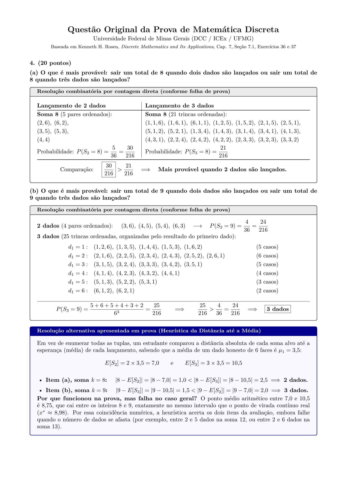
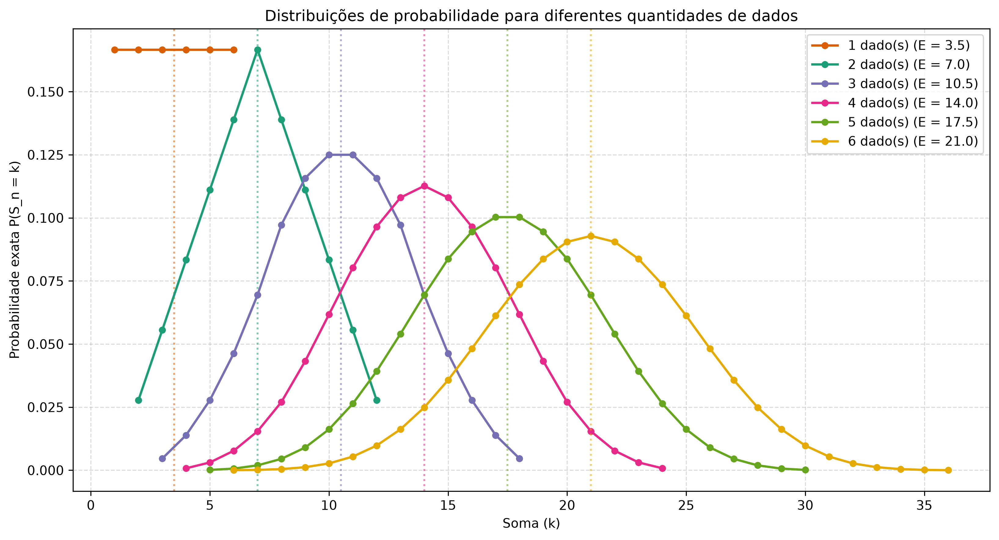
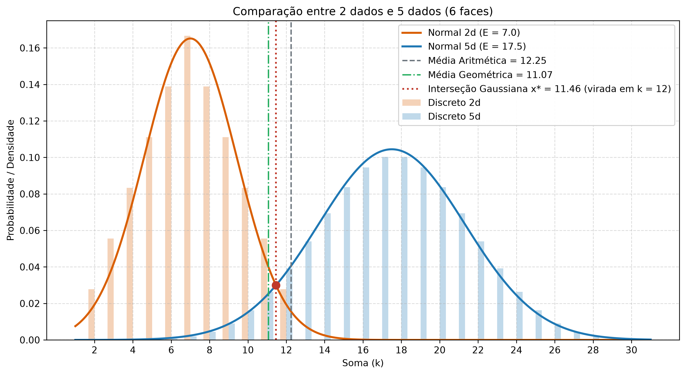
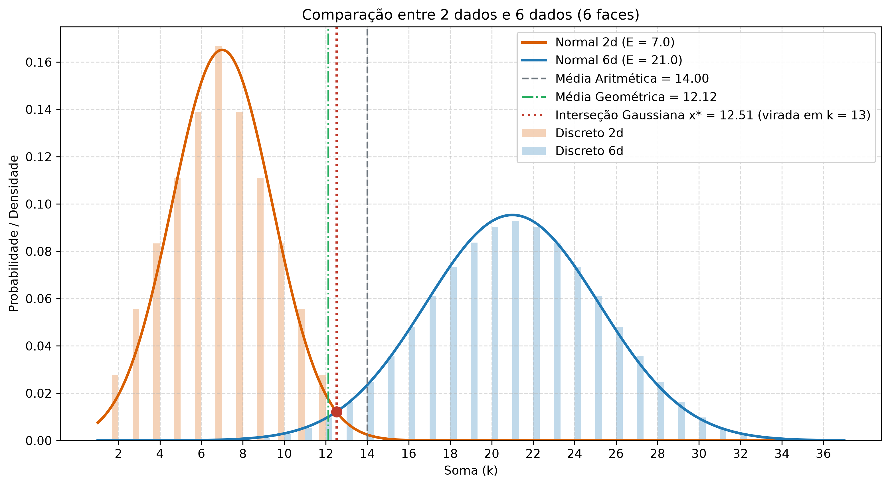
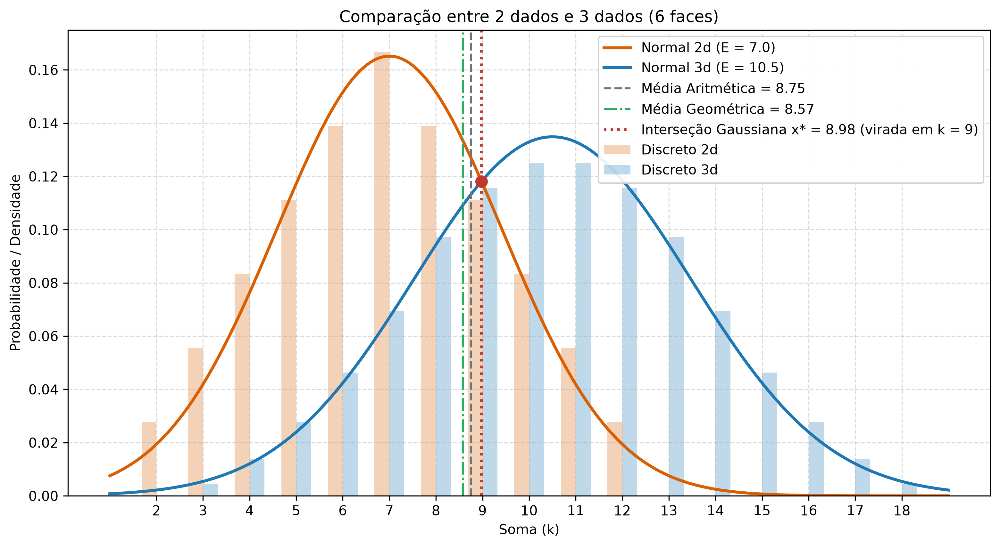

# Soma de Dados e o Ponto de Virada entre Distribuições

**Autor:** Ítalo Leal (Sistemas de Informação, DCC/ICEx, UFMG)

Este repositório reúne o código, os experimentos e o artigo em LaTeX nascidos de uma discussão após a primeira prova de Matemática Discreta na UFMG, ministrada pelo professor Jeroen van de Graaf.

---

## Como o problema surgiu

Na prova, a Questão 4 (retirada dos exercícios 36 e 37 do Capítulo 7.1 do livro *Discrete Mathematics and Its Applications*, de Kenneth H. Rosen) fazia duas perguntas seguidas sobre o lançamento de dados honestos de 6 faces:

1. **(a)** O que é mais provável: sair um total de **8** quando dois dados são lançados ou quando três dados são lançados?
2. **(b)** O que é mais provável: sair um total de **9** quando dois dados são lançados ou quando três dados são lançados?

Pela contagem combinatória tradicional (como na [imagem original da prova](assets/questao_original_p1.png)), basta listar as tuplas possíveis:
- Na **soma 8**, 2 dados têm $5$ combinações em $36$ ($P = \frac{5}{36} = \frac{30}{216} \approx 13{,}89\%$), enquanto 3 dados têm $21$ combinações em $216$ ($P = \frac{21}{216} \approx 9{,}72\%$). Logo, **2 dados** vencem.
- Na **soma 9**, 2 dados têm $4$ combinações em $36$ ($P = \frac{4}{36} = \frac{24}{216} \approx 11{,}11\%$), enquanto 3 dados têm $25$ combinações em $216$ ($P = \frac{25}{216} \approx 11{,}57\%$). Logo, **3 dados** vencem.

Um amigo meu resolveu a questão de outro jeito, sem listar as combinações: ele calculou a média (esperança) de 2 dados ($E[S_2] = 7{,}0$) e a média de 3 dados ($E[S_3] = 10{,}5$) e olhou para a distância de cada soma até essas médias:
- No item (a), $8$ está a distância $1{,}0$ de $7{,}0$ e a distância $2{,}5$ de $10{,}5$, então ele marcou **2 dados**.
- No item (b), $9$ está a distância $1{,}5$ de $10{,}5$ e a distância $2{,}0$ de $7{,}0$, então ele marcou **3 dados**.

Na correção inicial, o professor não deu os pontos totais porque essa justificativa pela distância até a média não era uma prova geral. Meu amigo foi conversar com o professor para defender a ideia e eu fui junto acompanhar a discussão. No fim, o professor deu a pontuação total aos alunos porque, apesar de a regra não valer sempre, o raciocínio era inteligente.

Saí daquela conversa querendo entender melhor o problema. Na madrugada de 13 de dezembro de 2024, enviei um e-mail ao professor Jeroen com um contraexemplo comparando **2 dados e 6 dados** nas somas $13$ e $14$, mostrando que a média aritmética das esperanças falhava, e levantei a conjectura de que o ponto real de cruzamento entre as curvas era governado pela **média geométrica** das esperanças ($\mu_G = \sqrt{E[S_n] \cdot E[S_m]}$). O professor respondeu na manhã seguinte convidando para debatermos o argumento após a aula.

A partir daquela discussão, desenvolvi este projeto para responder de vez às três perguntas centrais: **por que a distância até a média funcionou nos dois itens da prova, onde ela quebra e qual é a fórmula exata para o ponto em que uma quantidade de dados passa a ser mais provável que outra?**



*(Veja a [imagem original da folha de prova](assets/questao_original_p1.png) e a versão recriada em LaTeX em [`paper/questao_p1_recriada.pdf`](paper/questao_p1_recriada.pdf)).*

---

## Onde a distância até a média falha

Usar a menor distância até a média ($|k - E[S_n]| < |k - E[S_m]|$) equivale a assumir que o ponto de virada entre $n$ dados e $m$ dados fica sempre na **média aritmética** das duas esperanças:

$$\mu_A(n, m) = \frac{E[S_n] + E[S_m]}{2}$$

O problema é que, quando aumentamos o número de dados, duas coisas mudam ao mesmo tempo na distribuição:
1. **A variância cresce linearmente** ($\text{Var}(S_n) = n \cdot \frac{35}{12}$), espalhando a curva de $m$ dados por um intervalo muito mais largo.
2. **O pico da distribuição diminui** na ordem de $1/\sqrt{n}$, deixando a curva de $n$ dados mais alta perto do seu centro.



Por causa disso, a regra da distância até a média pode errar nas **duas direções**:

### 1. Erro mesmo dentro das somas possíveis: 2 dados vs 5 dados (soma 12)
Compare $2$ dados ($E[S_2] = 7{,}0$) com $5$ dados ($E[S_5] = 17{,}5$) na soma $k = 12$ (que é possível nos dois lançamentos, já que $(6,6)$ soma $12$):
- Distância até a média de 2 dados: $|12 - 7{,}0| = 5{,}0$
- Distância até a média de 5 dados: $|12 - 17{,}5| = 5{,}5$

Como $5{,}0 < 5{,}5$, a soma $12$ está mais próxima da média de 2 dados. Mesmo assim, a probabilidade real com 5 dados é maior:

$$P(S_2 = 12) = \frac{1}{36} \approx 2{,}78\% \quad < \quad P(S_5 = 12) = \frac{305}{7776} \approx 3{,}92\%$$



### 2. Erro na direção contrária: 4 dados vs 5 dados (soma 16)
Compare $4$ dados ($E[S_4] = 14{,}0$) com $5$ dados ($E[S_5] = 17{,}5$) na soma $k = 16$:
- A soma $16$ está mais perto da média de 5 dados ($|16 - 17{,}5| = 1{,}5$) do que da média de 4 dados ($|16 - 14{,}0| = 2{,}0$).
- Porém, como o pico de 4 dados é mais alto, **4 dados ainda vencem na soma 16**:

$$P(S_4 = 16) = \frac{125}{1296} = \frac{750}{7776} \approx 9{,}65\% \quad > \quad P(S_5 = 16) = \frac{735}{7776} \approx 9{,}45\%$$

### 3. Erro fora do limite máximo de 2 dados: 2 dados vs 6 dados (somas 13 e 14)
Compare $2$ dados ($E[S_2] = 7{,}0$) com $6$ dados ($E[S_6] = 21{,}0$), cuja média aritmética é $14{,}0$:
- Na soma $k = 13$, a distância até a média de 2 dados é $6{,}0$, menor que a distância até a média de 6 dados ($8{,}0$).
- A regra da distância diria que $13$ é mais provável com 2 dados, mas $13$ é impossível em 2 dados ($P(S_2 = 13) = 0\%$, contra $P(S_6 = 13) \approx 1{,}62\%$).



---

## O ponto de virada real: Média Geométrica e Média Logarítmica

Aproximando a soma de $n$ dados pela distribuição normal $\mathcal{N}(n\mu_1, n\sigma_1^2)$ (via Teorema Central do Limite) e igualando as densidades de $n$ dados e $m$ dados ($f_n(x) = f_m(x)$), chegamos a:

$$\frac{(x - n\mu_1)^2}{n} - \frac{(x - m\mu_1)^2}{m} = \sigma_1^2 \ln\!\left(\frac{m}{n}\right)$$

Ao expandir os quadrados, **o termo linear em $x$ se cancela exatamente** ($-2\mu_1 x + 2\mu_1 x = 0$), porque a razão entre média e variância na soma de variáveis i.i.d. não depende da quantidade de dados ($\frac{n\mu_1}{n\sigma_1^2} = \frac{\mu_1}{\sigma_1^2}$). Isolando $x > 0$, obtemos a fórmula fechada do ponto de interseção:

$$x^*(n, m) = \mu_G(n, m) \sqrt{1 + \frac{\text{CV}_1^2}{L(n, m)}}$$

onde:
- $\mu_G(n, m) = \sqrt{E[S_n] E[S_m]} = \mu_1 \sqrt{nm}$ é a **média geométrica** das esperanças;
- $L(n, m) = \frac{m - n}{\ln(m) - \ln(n)}$ é a **média logarítmica** entre $n$ e $m$;
- $\text{CV}_1^2 = \frac{\sigma_1^2}{\mu_1^2} = \frac{s - 1}{3(s + 1)}$ é o quadrado do **coeficiente de variação** de um dado (para $6$ faces, $\text{CV}_1^2 = \frac{5}{21} \approx 0{,}2381$).

### Por que deu certo na prova (2d vs 3d)?
Para $n = 2$ e $m = 3$:
- Média geométrica: $\mu_G = 8{,}5732$
- Média aritmética (usada pelo meu amigo): $\mu_A = 8{,}7500$
- Ponto de virada contínuo real: $x^* = 8{,}9775$

Como tanto $8{,}75$ quanto $8{,}98$ caem entre os inteiros $8$ e $9$, qualquer corte entre $8$ e $9$ dá exatamente a mesma resposta para valores inteiros: até $8$ dá 2 dados, e de $9$ em diante dá 3 dados.



### Resumo comparativo para vários pares de dados

| Par de dados | $E[S_n]$ | $E[S_m]$ | Média Geométrica ($\mu_G$) | Média Aritmética ($\mu_A$) | Ponto de Virada ($x^*$) | Virada Discreta Exata |
| :---: | :---: | :---: | :---: | :---: | :---: | :---: |
| **2d vs 3d** | 7,0 | 10,5 | 8,5732 | 8,7500 | **8,9775** | **k = 9** |
| **3d vs 4d** | 10,5 | 14,0 | 12,1244 | 12,2500 | **12,5327** | **k = 13** |
| **4d vs 5d** | 14,0 | 17,5 | 15,6525 | 15,7500 | **16,0629** | **k = 17** |
| **3d vs 5d** | 10,5 | 17,5 | 13,5554 | 14,0000 | **13,9615** | **k = 14** *(empate exato: $5/72$)* |
| **2d vs 4d** | 7,0 | 14,0 | 9,8995 | 10,5000 | **10,2998** | **k = 11** |
| **2d vs 5d** | 7,0 | 17,5 | 11,0680 | 12,2500 | **11,4633** | **k = 12** |
| **3d vs 6d** | 10,5 | 21,0 | 14,8492 | 15,7500 | **15,2522** | **k = 16** |
| **2d vs 6d** | 7,0 | 21,0 | 12,1244 | 14,0000 | **12,5145** | **k = 13** |

*(Curiosidade: o par **3d vs 5d** na soma $k = 14$ é o único caso não trivial para dados de 6 faces em que as probabilidades discretas empatam exatamente, $P(S_3 = 14) = P(S_5 = 14) = \frac{5}{72} \approx 6{,}94\%$, como já aparecia na [planilha inicial do laboratório](assets/planilha_exploratoria_dados.ods)).*

---

## Provas e Evidências de que a Fórmula Está Correta

A validade da fórmula fechada $x^*(n, m) = \mu_G(n, m) \sqrt{1 + \frac{\text{CV}_1^2}{L(n, m)}}$ pode ser comprovada de quatro formas independentes (todas reproduzíveis rodando `python main.py --verify`):

### 1. Prova por substituição algébrica direta (erro zero)
Para que duas densidades normais $f_n(x)$ e $f_m(x)$ sejam idênticas em $x^*$, a diferença entre seus expoentes quadráticos precisa igualar exatamente $2\ln(\sigma_m / \sigma_n) = \ln(m / n)$:

$$\Delta(x) = \frac{(x - n\mu_1)^2}{n\sigma_1^2} - \frac{(x - m\mu_1)^2}{m\sigma_1^2} = \frac{1}{\sigma_1^2}\left[\left(\frac{m - n}{nm}\right) x^2 - \mu_1^2(m - n)\right]$$

Substituindo $x^2 = (x^*)^2 = nm\mu_1^2 \left(1 + \frac{\sigma_1^2}{\mu_1^2} \frac{\ln(m/n)}{m - n}\right)$ diretamente na expressão acima:

$$\Delta(x^*) = \frac{1}{\sigma_1^2}\left[(m - n)\mu_1^2 + \sigma_1^2 \ln\!\left(\frac{m}{n}\right) - \mu_1^2(m - n)\right] = \ln\!\left(\frac{m}{n}\right)$$

Os termos $(m - n)\mu_1^2$ cancelam-se de forma exata, resultando em $f_n(x^*) = f_m(x^*)$ sem nenhuma aproximação intermediária.

### 2. Verificação numérica independente (Bisseção vs Fórmula Fechada)
No módulo [`src/crossover.py`](src/crossover.py), a função `verify_gaussian_crossover` encontra a raiz da equação $f_n(x) - f_m(x) = 0$ no intervalo $[\mu_n, \mu_m]$ pelo método numérico da bisseção (sem usar a fórmula) e também avalia o resíduo $|f_n(x^*) - f_m(x^*)|$:

| Par | Fórmula Fechada ($x^*$) | Raiz Numérica por Bisseção | Resíduo $\|f_n(x^*) - f_m(x^*)\|$ | Razão $x^* / \mu_G$ | $\lceil x^* \rceil = k_{\text{cross}}$ |
| :---: | :---: | :---: | :---: | :---: | :---: |
| **2d vs 3d** | `8.97750742` | `8.97750742` | `8.33e-17` | `1.047158` | Sim ($k = 9$) |
| **3d vs 4d** | `12.53271210` | `12.53271210` | `1.39e-17` | `1.033681` | Sim ($k = 13$) |
| **4d vs 5d** | `16.06289847` | `16.06289847` | `2.78e-17` | `1.026221` | Sim ($k = 17$) |
| **3d vs 5d** | `13.96152966` | `13.96152966` | `8.33e-17` | `1.029958` | Sim ($k = 14$) |
| **2d vs 5d** | `11.46334952` | `11.46334952` | `6.94e-17` | `1.035723` | Sim ($k = 12$) |
| **2d vs 6d** | `12.51450588` | `12.51450588` | `2.95e-17` | `1.032179` | Sim ($k = 13$) |
| **10d vs 20d** | `49.90424416` | `49.90424416` | `6.51e-18` | `1.008218` | Sim ($k = 50$) |
| **50d vs 100d** | `247.89547783` | `247.89547783` | `3.93e-24` | `1.001649` | Sim ($k = 248$) |

O resíduo $|f_n(x^*) - f_m(x^*)|$ fica na ordem de $10^{-17}$ a $10^{-24}$ (zero absoluto na precisão de máquina de 64 bits IEEE 754).

### 3. Confirmação assintótica da conjectura da Média Geométrica
Quando o número de dados cresce ($n, m \to \infty$), a média logarítmica $L(n, m) \ge \sqrt{nm} \to \infty$ faz o termo $\frac{\text{CV}_1^2}{L(n, m)}$ tender a zero:

$$\lim_{n, m \to \infty} \frac{x^*(n, m)}{\mu_G(n, m)} = \lim_{n, m \to \infty} \sqrt{1 + \frac{\text{CV}_1^2}{L(n, m)}} = 1$$

Veja na coluna $x^* / \mu_G$ da tabela acima como a razão cai de $1{,}047$ (em `2d vs 3d`) para $1{,}008$ (em `10d vs 20d`) e $1{,}0016$ (em `50d vs 100d`). Isso prova que a **média geométrica** proposta no e-mail de 13/12/2024 é, de fato, o limite assintótico exato do ponto de interseção.

### 4. Concordância com a combinatória discreta de De Moivre
Em todos os pares testados, o primeiro inteiro $k_{\text{cross}}$ em que a probabilidade combinatória exata de $m$ dados supera ou empata com a de $n$ dados coincide com o teto da fórmula contínua: $k_{\text{cross}} = \lceil x^*(n, m) \rceil$.

---

## Artigo em LaTeX

O desenvolvimento matemático completo, incluindo o contexto histórico (Galileu e De Moivre), a dedução por funções geradoras, a demonstração do cancelamento linear, a condição crítica entre $x^*$ e a média aritmética e as provas de verificação, está disponível na pasta [`paper/`](paper/):

- 📄 **[Artigo completo compilado (`paper/artigo.pdf`)](paper/artigo.pdf)** | [Código-fonte LaTeX (`paper/artigo.tex`)](paper/artigo.tex)
- 📝 **[Questão da prova recriada (`paper/questao_p1_recriada.pdf`)](paper/questao_p1_recriada.pdf)** | [Código-fonte LaTeX (`paper/questao_p1_recriada.tex`)](paper/questao_p1_recriada.tex)
- 📚 **[Referências bibliográficas (`paper/referencias.bib`)](paper/referencias.bib)**

---

## Estrutura do repositório

```text
discrete-dice-analysis/
├── main.py                              # Script principal de linha de comando (CLI)
├── requirements.txt                     # Dependências Python (numpy e matplotlib)
├── README.md                            # Documentação e contextualização do projeto
├── LICENSE                              # Licença MIT
├── src/                                 # Módulos Python
│   ├── __init__.py
│   ├── dice_odds.py                     # Cálculo combinatório exato (memoização e fórmula de De Moivre)
│   ├── crossover.py                     # Ponto de interseção gaussiano (x*), verificação e médias clássicas
│   ├── monte_carlo.py                   # Simulação estocástica de Monte Carlo
│   └── plot.py                          # Geração dos gráficos com Matplotlib
├── paper/                               # Artigo científico e recriação da questão em LaTeX
│   ├── artigo.tex
│   ├── artigo.pdf
│   ├── questao_p1_recriada.tex
│   ├── questao_p1_recriada.pdf
│   ├── referencias.bib
│   └── figures/                         # Figuras vetoriais (.pdf) usadas no artigo
└── assets/                              # Imagens, gráficos (.png) e planilha original (.ods)
    ├── questao_original_p1.png
    ├── questao_p1_recriada.png
    ├── planilha_exploratoria_dados.ods
    ├── distribuicoes_1d_a_6d.png
    ├── crossover_2d_3d.png
    ├── crossover_2d_5d.png
    └── crossover_2d_6d.png
```

---

## Como executar o código

### 1. Instalar dependências

```bash
pip install -r requirements.txt
```

### 2. Rodar pelo terminal (`main.py`)

```bash
# Reproduzir a análise da questão da prova (itens a e b), contraexemplos e verificação da fórmula
python main.py

# Rodar apenas a tabela de verificação algébrica e numérica da fórmula x*(n, m)
python main.py --verify

# Comparar quaisquer duas quantidades de dados (ex: 4 dados vs 5 dados)
python main.py --compare 4 5

# Abrir os gráficos interativos
python main.py --compare 2 5 --plot

# Regerar todas as figuras nas pastas assets/ e paper/figures/
python main.py --save-plots
```

### 3. Usar as funções em outros scripts Python

```python
from src.dice_odds import exact_dice_odds, de_moivre_dice_probability
from src.crossover import exact_gaussian_crossover, discrete_crossover_point, verify_gaussian_crossover
from src.monte_carlo import monte_carlo_odds

# Probabilidade exata da soma 8 e da soma 9 com 2 e 3 dados
print(exact_dice_odds(sum_value=8, num_dice=2))  # 0.138888... (30/216)
print(exact_dice_odds(sum_value=8, num_dice=3))  # 0.097222... (21/216)
print(exact_dice_odds(sum_value=9, num_dice=2))  # 0.111111... (24/216)
print(exact_dice_odds(sum_value=9, num_dice=3))  # 0.115740... (25/216)

# Ponto de virada contínuo (x*), virada discreta (k_cross) e verificação de precisão
x_star = exact_gaussian_crossover(n=2, m=3, sides=6)
k_cross, p_2d, p_3d = discrete_crossover_point(n=2, m=3, sides=6)
verificacao = verify_gaussian_crossover(n=2, m=3, sides=6)
print(f"x* = {x_star:.4f}, virada discreta em k = {k_cross}, residuo = {verificacao['density_residual']:.2e}")

# Simulação de Monte Carlo (100.000 lançamentos)
print(monte_carlo_odds(target_sum=8, num_dice=3, num_rolls=100_000, seed=42))
```

---

## Licença

Distribuído sob a licença MIT. Veja o arquivo [LICENSE](LICENSE) para mais detalhes.